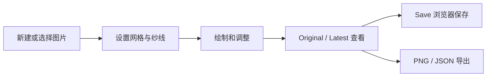
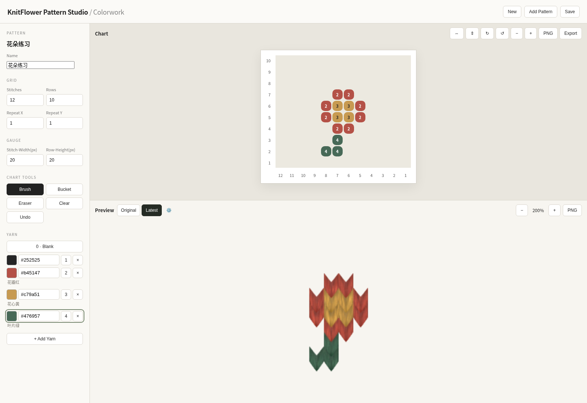
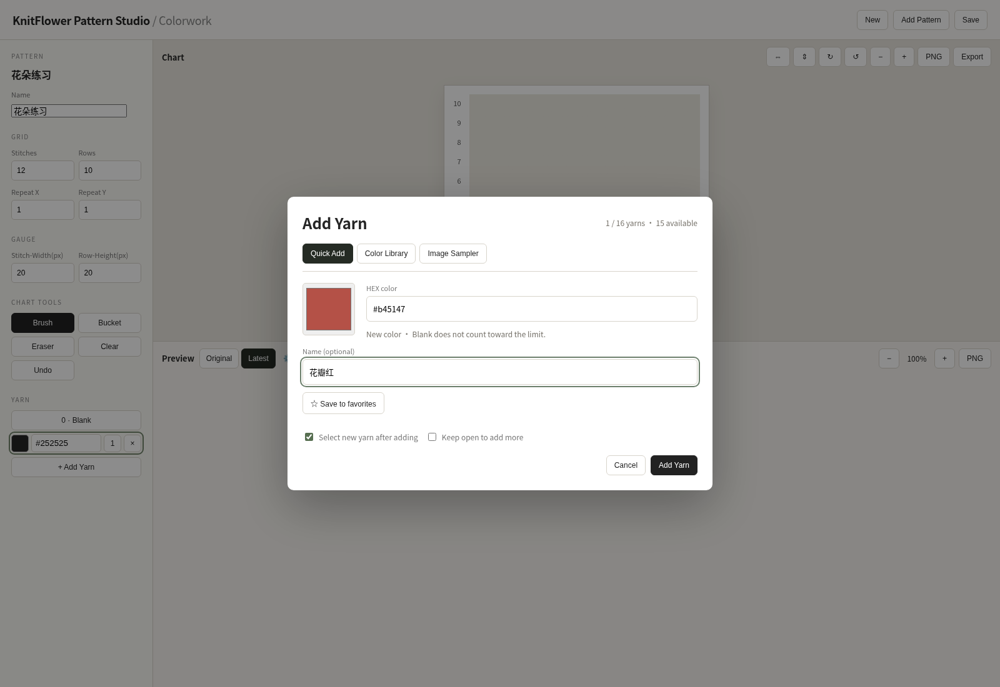
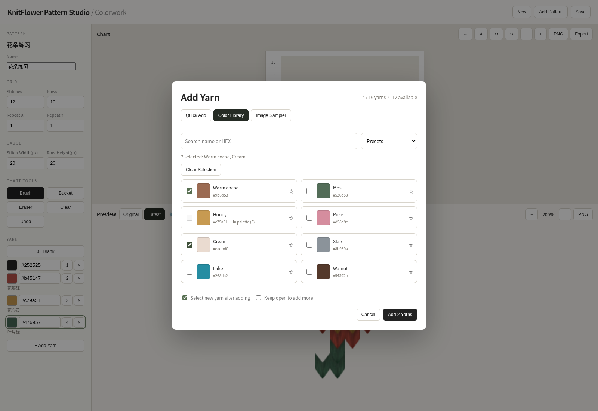
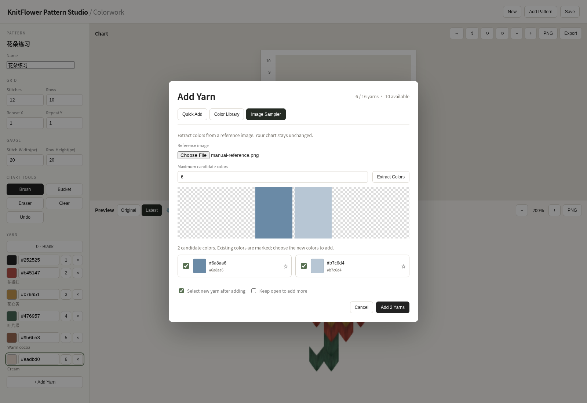
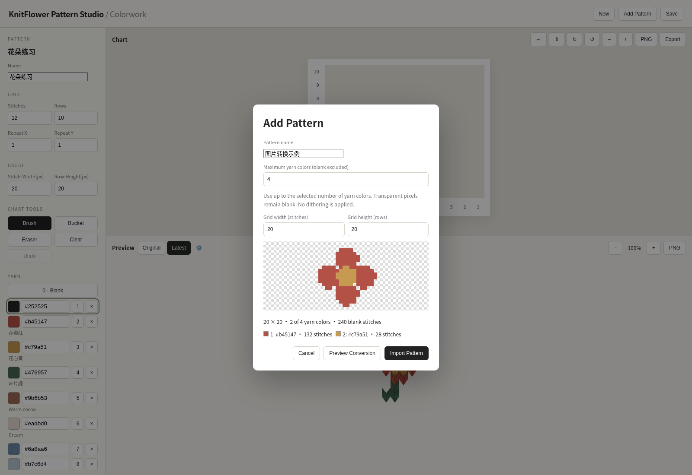
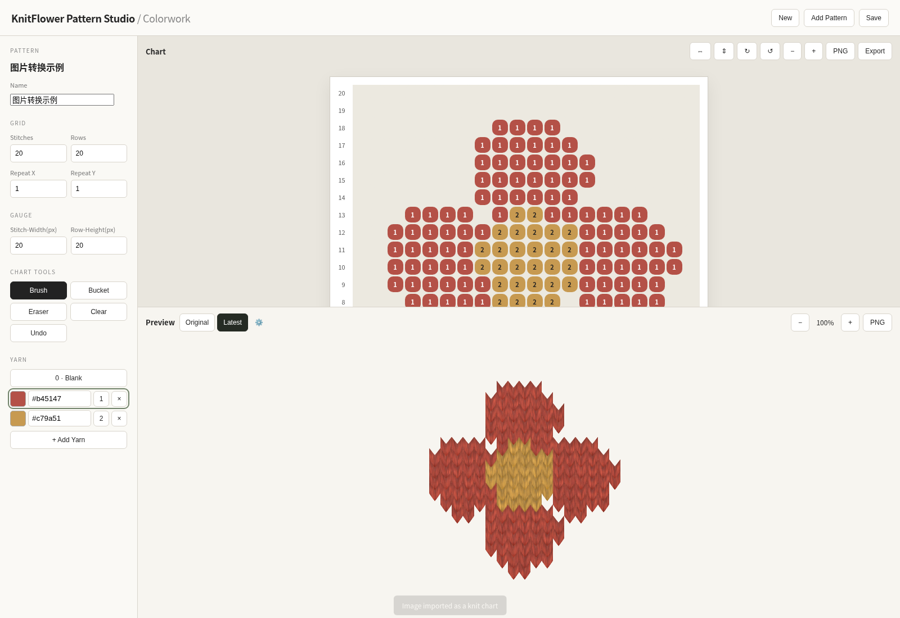
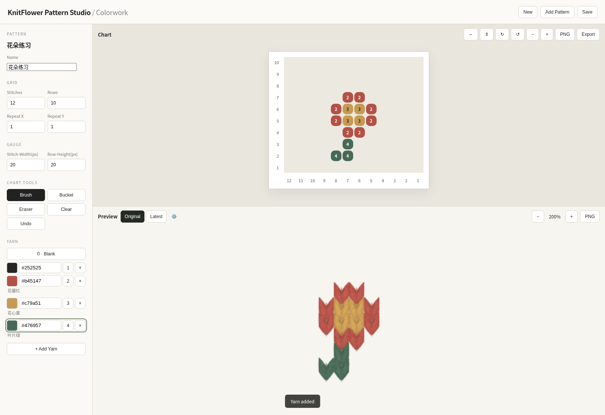

# KnitFlower Pattern Studio 使用说明书

这是一个在浏览器中编辑针织配色图样、查看针织模拟效果的工具。图样编辑、纱线管理、图片转图样、两种 Preview 模式和图片导出都在同一页面完成。

本文截图来自本版实际操作。示例图样仅用于说明，首次打开时不一定显示相同内容。

## 目录

1. [五分钟上手](#五分钟上手)
2. [界面分区](#界面分区)
3. [新建与网格设置](#新建与网格设置)
4. [添加和管理纱线](#添加和管理纱线)
5. [绘制与修改图样](#绘制与修改图样)
6. [从图片生成图样](#从图片生成图样)
7. [Original / Latest 双模式](#original--latest-双模式)
8. [调整 Preview](#调整-preview)
9. [保存与导出](#保存与导出)
10. [练习示例](#练习示例)
11. [常见问题](#常见问题)
12. [功能边界与版本信息](#功能边界与版本信息)

## 五分钟上手

1. 点击右上角 **New** 新建图样。
2. 在左侧 **Name** 输入名称；按 Tab 或点击其他位置确认。
3. 设置 **Stitches** 和 **Rows**，例如 12 列、10 行。
4. 在 **Yarn** 选择一个非空白颜色；需要其他颜色时点击 **+ Add Yarn**。
5. 选择 **Brush**，在 Chart 中点击或拖动绘制。
6. 点击 Preview 后的 **Original / Latest**，比较同一图样的两种效果。
7. 点击 **Save** 保存当前浏览器中的图样。
8. 点击 **Chart → PNG** 下载纯图案和完整编号图；点击 **Preview → PNG** 下载当前模式的针织效果。

## 界面分区

| 区域 | 用途 |
| --- | --- |
| 顶部 New / Add Pattern / Save | 新建、从图片导入、保存图样 |
| 左侧 Pattern / Grid / Gauge | 名称、网格行列、预览重复次数及针目像素尺寸 |
| 左侧 Chart Tools / Yarn | 绘图工具、纱线选择与颜色管理 |
| Chart | 编辑针目；格内数字对应纱线编号 |
| Preview | 查看原版或最新版针织效果，调整缩放并导出 |

窗口较窄时区域会重新排列。大图可在 Chart 和 Preview 各自的区域中滚动查看。

## 新建与网格设置

### 新建

**New** 创建 20 × 20 空白图样，并提供一种深色纱线。第一次直接打开页面、且没有浏览器存档时，默认网格为 12 × 10。

新建会替换当前编辑内容。需要保留的图样应先保存并导出；尚未刷新时可尝试用 Undo 返回上一步。

### 名称与尺寸

| 控件 | 含义 | 当前有效范围 |
| --- | --- | --- |
| Name | 图样名称，也用于导出文件名 | 未填写时使用默认名称 |
| Stitches | 网格列数 | 1–40 |
| Rows | 网格行数 | 1–40 |

当前实现的实际网格上限为 **40 × 40**；即使输入框能输入更大的数字，尺寸调整仍会按上限处理。

扩大网格时保留已有针目，新区域为空白；缩小时超出范围的部分会被裁掉。误操作后可点击 Undo。

## 添加和管理纱线

左侧 **Yarn** 中，`0 · Blank` 表示空针，不是一种白色纱线。非空白纱线最多 16 种。

### Quick Add：手动选色

1. 点击 **+ Add Yarn**。
2. 在 **Quick Add** 页签使用选色器，或输入六位 HEX 颜色，例如 `#b45147`。
3. 可填写 **Name (optional)**，方便识别颜色。
4. 点击 **Add Yarn**。

- **Select new yarn after adding**：添加后选中新纱线。
- **Keep open to add more**：添加后保持窗口打开，便于继续添加。
- **☆ Save to favorites**：把颜色加入当前浏览器的收藏。
- 输入已有颜色时，会选择已有纱线，不重复占用颜色槽位。

### Color Library：从色库批量添加

1. 打开 **Color Library**。
2. 可切换 Presets、Favorites、Recent、All colors，或按名称／HEX 搜索。
3. 勾选需要的颜色，再点击底部添加按钮。

已经在当前 Yarn 中的颜色会被标记，不重复添加。收藏与最近颜色保存在本浏览器中，不是云端账号数据。

### Image Sampler：只从图片取色

1. 打开 **Image Sampler** 并选择参考图片。
2. 设置 **Maximum candidate colors**，范围 1–16。
3. 点击 **Extract Colors**。
4. 检查候选色，勾选需要的新颜色并添加。

Image Sampler 只向 Yarn 添加颜色，不把图片转换成图样。若要转换整张图片，请使用右上角 **Add Pattern**。

### 选择、修改与删除

- 点击纱线的**编号按钮**，将其设为当前绘制颜色。
- 修改色值，会更新所有使用该编号的针目。
- 点击 **×** 删除纱线时，使用该色的针目会变为空白；后续编号会调整，其他针目的颜色保留。
- 删除错误时可点击 Undo。

## 绘制与修改图样

| 工具／按钮 | 操作效果 |
| --- | --- |
| Brush | 用当前纱线点击或拖动绘制 |
| Bucket | 填充与点击位置相连的同色区域，包括相连空白区域 |
| Eraser | 将针目擦为空白 |
| Clear | 确认后清空整张网格 |
| Undo | 撤销最近编辑；最多保留 50 个历史快照 |
| ⇔ / ⇕ | 水平／垂直翻转图样 |
| ↻ / ↺ | 顺时针／逆时针旋转；非正方形图样的行列会互换 |
| Chart 的 − / + | 调整编辑网格显示大小，不改变行列数 |

Chart 格内数字对应 Yarn 编号，空针不显示数字。左侧行号从上到下递减，底部列号从左到右递减；完整编号 PNG 会保留同样的方向。

Chart 的显示针目大小范围为 16–70 像素。它与 Preview 的针目像素尺寸、预览缩放是不同的设置。

## 从图片生成图样

### 选择与预览

1. 点击右上角 **Add Pattern**，选择 PNG、JPEG 等浏览器可读取的图片。
2. 设置 **Pattern name**。
3. 设置 **Maximum yarn colors**：1–16，不包括空白。
4. 设置 **Grid width / Grid height**：各 1–40。
5. 点击 **Preview Conversion**。
6. 检查转换预览、颜色列表、各色针数和空针数。
7. 确认后点击 **Import Pattern**。

修改参数后，需要再次点击 Preview Conversion。没有有效预览时，Import Pattern 不可用。

### 导入后

导入会替换当前编辑图样，可继续用 Brush、Bucket 等工具修改，也可切换 Original / Latest 查看。误导入可在刷新前尝试 Undo。

小网格会丢失图片细节，减少颜色也会改变效果。建议优先使用清晰、色块明确的素材；逐步调整网格尺寸和颜色上限，再比较预览。

透明区域可转换为空针，白色背景会被视为一种实际颜色。希望保留空针时，优先使用透明背景 PNG。当前转换不使用抖动来混色。

## Original / Latest 双模式

| 按钮 | 主要区别 |
| --- | --- |
| Original | 最初版的针目、纹理、光照与叠放效果 |
| Latest | 包含侧向端口、对称单 V 尖及上部颜色连续修正的最新版效果 |

点击 **Preview** 后的按钮切换，深色按钮是当前选择。

两种模式共用同一图样、纱线和参数。切换不会重建图样，也不会清空撤销历史；缩放与查看位置会保留。浏览器会单独记住模式偏好，无法使用本地存储时仍可切换。

两种效果都是二维模拟预览，不是实物织物照片，也不是实际编织尺寸。

## 调整 Preview

| 控件 | 用途 | 有效范围／说明 |
| --- | --- | --- |
| Repeat X / Repeat Y | 在预览中横向／纵向重复图样 | 1–8 次；输入更大值时仍按上限显示 |
| Stitch-Width(px) | 每针的预览像素宽度 | 8–120 |
| Row-Height(px) | 每行的预览像素高度 | 8–120 |
| Preview − / + | 缩放当前视图 | 40%–400%，每次约 20 个百分点 |
| ⚙ → StitchStroke | 调整针目接触阴影／描边效果 | 0–2.5 |

Repeat 只扩展预览，不扩大原始编辑网格。Gauge 中的像素尺寸不是厘米，也不等同于实际针织密度。

Preview 缩放改变显示大小，不改变导出 PNG 的像素分辨率。Gauge 和 Repeat 会影响导出内容与尺寸；极大预览会按比例降低位图分辨率以控制资源占用。

## 保存与导出

### Save：在当前浏览器中继续编辑

点击右上角 **Save**，将当前图样保存到浏览器 localStorage。重新打开同一地址时会尝试恢复。

需要注意：

- 只有一个当前图样存档槽位，再次保存会覆盖上一份。
- 修改不会自动保存，需要主动点击 Save。
- 保存图样名称、网格、颜色和纱线名称；Repeat、Gauge、StitchStroke、缩放与撤销历史不会随 Save 恢复。模式偏好另行记忆。
- 更换浏览器、站点地址或端口，或清理站点数据后，可能无法找到旧存档。
- Save 不会上传 GitHub，也不等于保存到账号云端。

### Chart → PNG：一次下载两张

| 文件名示例 | 内容 | 常见用途 |
| --- | --- | --- |
| `花朵练习_chart.png` | 纯色针目图，固定 16 像素／针；空针透明 | 分享色块图、作为其他处理流程的输入 |
| `花朵练习_chart_annotated.png` | 完整 Chart 卡片，包含针目数字、行列编号、网格和边框 | 阅读图表、打印和核对针目 |

完整图表采用当前 Chart 缩放和样式，包含滚动区域外的所有针目；较大图表会等比例缩小以控制位图尺寸。

浏览器可能要求允许一个页面连续下载多个文件。如果只下载了一张，请检查下载权限，允许后重试。

### Preview → PNG：导出当前模式

- Original 模式：`花朵练习_preview_original.png`
- Latest 模式：`花朵练习_preview_latest.png`

导出包含当前 Gauge、Repeat 和所选模式的效果，空针区域保持透明。若要比较两种模式，保持参数相同，分别切换后各导出一次。

### Chart → Export：下载 JSON

Export 下载 blueprint JSON，包含名称、行列、逐格颜色和针目像素尺寸等数据，适合交给其他程序处理。

**当前页面没有 JSON 导入入口。** 不能把 Export 当作可直接在本页面打开的项目文件。Add Pattern 接受图片；PNG 重新导入会重新取样与减色，不等同于无损恢复原始编辑状态。

## 练习示例

尝试制作一张 12 × 10 的小花图样：

1. New → Name 填写“花朵练习” → Stitches 12、Rows 10。
2. 添加花瓣红 `#b45147`、花心黄 `#c79a51`、叶片绿 `#476957`。
3. 用红色画花瓣，黄色填花心，绿色画茎叶；误画时使用 Eraser 或 Undo。
4. 分别点击 Original 和 Latest，比较端口、纤维与光照效果。
5. 将 Repeat X / Y 设为 2，观察连续图案，再恢复为 1。
6. Save 后，导出完整编号图，以及两种模式的 Preview PNG。

完成后应能得到一份可阅读的针目图，以及两种使用同一配色的针织模拟图。

## 常见问题

| 问题 | 处理方法 |
| --- | --- |
| 新建后 Preview 空白 | 新网格全部为空针，先选择非空白纱线并绘制 |
| 两个模式看起来接近 | 用包含亮色、深色和边界的图样比较，并提高 Preview 显示倍率 |
| 添加颜色按钮不可用 | 检查 HEX 是否为六位、是否已有该颜色，以及是否达到 16 色上限 |
| Import Pattern 灰色 | 完成 Preview Conversion；参数修改后需再次预览 |
| 图片颜色／细节不理想 | 提高网格尺寸或颜色上限，使用轮廓清楚的素材后再次预览 |
| 删除颜色后针目消失 | 使用该色的针目会变为空白；可点击 Undo |
| 刷新后未恢复最新编辑 | 确认已点击 Save，并使用同一浏览器和访问地址 |
| 刷新后 Repeat / Gauge 变回默认值 | 这些是显示参数，不随图样 Save 保存，需要重新设置 |
| Chart PNG 只下载一张 | 允许页面下载多个文件，然后重试 |
| 大图没有全部显示 | 在面板内滚动或缩小显示；完整编号导出仍包含全部内容 |

## 功能边界与版本信息

本说明适用于本仓库网页的界面和功能。以后功能更新时，以仓库对应版本和页面实际提示为准。

网页没有账号、云端图样库或多项目管理功能。图片转换和渲染在浏览器中完成；本版无需 API 密钥或联网下载材质，但需要妥善保留浏览器存档和导出成果。

操作截图已在独立浏览器上下文中验证：新建、编辑、纱线快速添加、色库批量添加、图片取色、模式切换、Save 后重载以及图片转换导入。未修改用户已有的浏览器存档。
